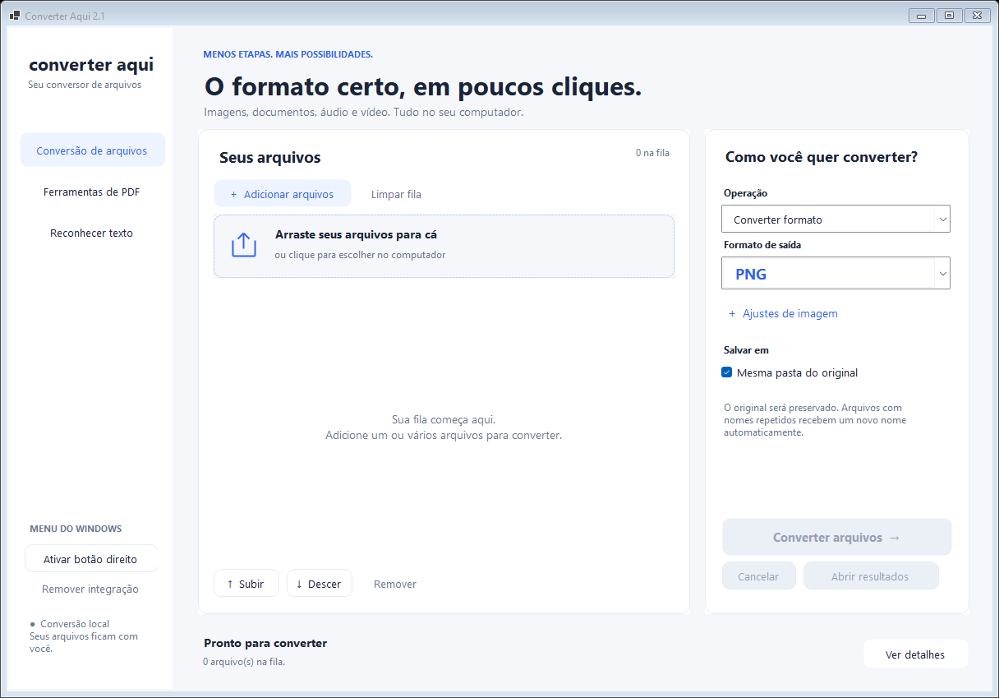

# Converter Aqui

Conversor local de arquivos para Windows, com menu do botão direito e conversão em lote.

**[Baixar o instalador completo](https://github.com/ArthurHermes/converter-aqui/releases/latest)**

Baixe `ConverterAqui-2.1.0-Setup-win-x64.exe`, execute e siga as instruções. O instalador inclui o runtime da interface e os mecanismos de conversão. Não é necessário instalar Python, .NET, Microsoft Office, LibreOffice, FFmpeg ou Tesseract separadamente. Depois do download, a instalação e as conversões funcionam offline.

## Recursos

- Imagens entre PNG, JPG, WebP, HEIC, BMP, GIF e TIFF; SVG como entrada rasterizada.
- Imagens para PDF, PDF para imagens, juntar, separar e selecionar páginas, extrair texto e imagens.
- OCR offline em português e inglês, com saída TXT.
- Áudio em MP3, WAV, FLAC, OGG e M4A; vídeo em MP4, MKV e WebM; extração de áudio.
- Word e Excel para PDF pelo LibreOffice incluído.
- Vários arquivos na fila, progresso, cancelamento e preservação dos originais.

## Requisitos e uso

Windows 10 build 19041+ ou Windows 11, 64 bits. Reserve 2 GB para instalação e espaço para os arquivos temporários. A renderização de páginas de PDF usa o Windows PowerShell 5.1 que acompanha o Windows.

O instalador funciona por usuário, sem administrador. Para o menu de contexto, marque a opção durante a instalação ou use **Ativar botão direito** no app. No Windows 11, abra **Mostrar mais opções → Converter para…**.

O instalador ainda não tem assinatura digital de editor. O Windows pode mostrar uma confirmação de segurança ao abrir o download. O release inclui o SHA256 do arquivo para conferência.

## Compilar

As ferramentas de desenvolvimento são necessárias apenas para quem quer recompilar o projeto. O instalador distribuído já inclui os componentes de execução.

Requisitos de build: Windows x64, .NET SDK 10 e Inno Setup 7. Os binários terceiros da pasta do aplicativo instalado podem ser reutilizados como componentes de build:

```powershell
powershell.exe -NoProfile -ExecutionPolicy Bypass -File .\scripts\Build.ps1 -ComponentsFrom "$env:LOCALAPPDATA\Programs\ConverterAqui" -InnoCompiler "C:\caminho\Inno Setup 7\ISCC.exe"
```

O script publica o app com `--self-contained true`, copia os mecanismos e modelos de OCR e compila o instalador em `dist`. O instalador não baixa dependências durante a instalação.

Para executar as verificações de conversão usando o Python incluído:

```powershell
$env:CONVERTER_AQUI_APP = "$env:LOCALAPPDATA\Programs\ConverterAqui"
& "$env:CONVERTER_AQUI_APP\runtime\python.exe" .\tests\test_conversions.py
```

Os testes criam apenas arquivos sintéticos em `tests/generated`. Os resultados do build 2.1.0 acompanham o repositório; os detalhes de instalação estão no arquivo de verificação do release.

## Limites e privacidade

Os arquivos são processados localmente. GIF/TIFF multipágina usa o primeiro quadro. SVG não é vetor de saída. OCR gera TXT e deve ser revisado. Documentos complexos podem ter diferenças de paginação/fontes. PDFs protegidos precisam ser desbloqueados; assinaturas digitais e formulários não são garantidos após manipular páginas. O suporte de mídia depende do codec dentro do arquivo.

## Licença

O código do aplicativo é GPL-3.0-or-later. Os componentes terceiros conservam suas próprias licenças e avisos; consulte [TERCEIROS.md](third-party/TERCEIROS.md). Os binários distribuídos incluem os respectivos arquivos de licença. As fontes e URLs de distribuição dos componentes estão documentadas nos avisos e metadados.


